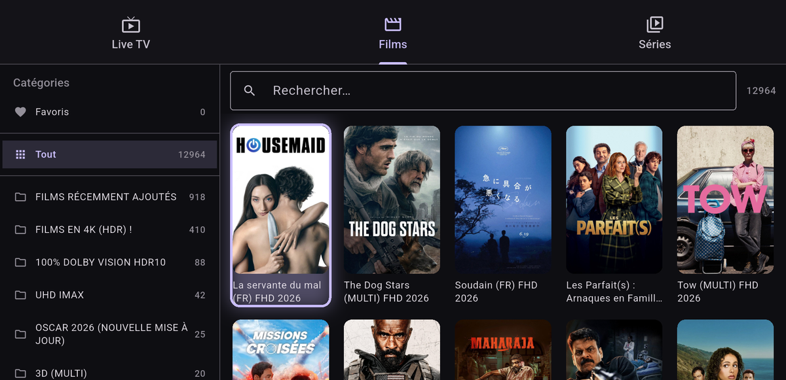

# Mizu IPTV (水)

**Français** · [English](#english)

Client IPTV **non officiel** pour Linux (et, à terme, Android / Android TV /
macOS), écrit en Flutter. Il se **synchronise avec un compte
[Zen IPTV](https://zeniptv.app/)** : profils, sources, favoris et reprise de
lecture.

La synchronisation dépend de l'offre payante **Zen Access** du compte Zen :
> Mizu ne la contourne pas, il la réutilise.

> Application de lecture uniquement : elle ne fournit aucun contenu. Il te faut
> ton propre abonnement IPTV et ton propre compte [Zen IPTV](https://zeniptv.app/).

<p align="center">
  
</p>

## État

| Fonction | État |
|---|---|
| Connexion au compte (email / mot de passe) | ✅ |
| Profils de visionnage + sélection | ✅ |
| Sources synchronisées (Xtream + M3U) | ✅ |
| Gérer les sources : ajouter / modifier / supprimer / tester | ✅ |
| Live TV / Films / Séries, colonne de catégories + recherche | ✅ |
| Favoris par profil (noms + affiches, ajout/retrait) | ✅ |
| Reprise de lecture (« Reprendre SxEy », saison et position) | ✅ |
| Lecteur libmpv : pistes audio et sous-titres | ✅ |
| Thème : suit Omarchy si présent, sinon thème par défaut | ✅ |
| Navigation télécommande / clavier (D-pad) | ✅ sources, catalogue, fiche, lecteur |
| Build Android / Android TV | ✅ APK debug + manifest TV (Leanback) |
| Build macOS | 🚧 à faire sur un Mac (Xcode) |

## Installer

### Une ligne (recommandé)

```bash
curl -fsSL https://raw.githubusercontent.com/iesta/mizu-iptv/main/tools/get.sh | sh
```

Le script télécharge la dernière AppImage, l'installe dans `~/.local` (sans
root), puis crée la commande `mizu`, l'entrée de menu et l'icône.

Il te demande **quel backend Supabase utiliser** :

- **par défaut, celui de Zen IPTV** — c'est le cas dans 99 % des cas, appuie
  sur Entrée (nécessite un compte [Zen IPTV](https://zeniptv.app/) avec
  l'abonnement Zen Access pour la synchro) ;
- réponds `n` pour **ta propre instance** : l'URL et la clé publishable te sont
  demandées (voir [`SUPABASE.md`](SUPABASE.md) pour préparer la base).

La configuration est écrite dans `~/.config/mizu/config.json` (mode 600), et
modifiable ensuite dans **Préférences**.

Lancer : `mizu` ou le menu Applications.
Désinstallation : `~/.local/share/mizu/uninstall.sh`.

### Autres méthodes

Paquets gérés (Flatpak, AUR, Homebrew), installation depuis les sources
(Debian, Fedora, Arch, NixOS) et construction des artefacts :
**[INSTALL.md](INSTALL.md)**.

## Lancer en développement

```bash
./tools/build.sh linux        # injecte .env dans le binaire
cd app && flutter run -d linux
```

`tools/build.sh` passe `--dart-define-from-file=../.env` : les valeurs de `.env`
sont **compilées** dans l'application, donc elle est configurée dès
l'installation (pratique pour un APK distribué).

Dépendances système (Linux) : `clang cmake ninja pkg-config libgtk-3-dev
libmpv` (media_kit).

## Android / Android TV

```bash
export ANDROID_HOME=~/dev/tools/android-sdk
./tools/build.sh apk-debug        # ou : apk (release)
adb install -r app/build/app/outputs/flutter-apk/app-debug.apk
```

L'APK embarque la configuration de `.env` : au premier lancement il va
directement à l'écran de connexion, sans demander l'URL ni la clé.

L'APK est marqué `LEANBACK_LAUNCHER` (il apparaît dans le lanceur TV), avec
bannière, `touchscreen` non requis et trafic HTTP en clair autorisé (la plupart
des panneaux IPTV ne sont pas en TLS).

Télécommande / manette :

| Touche | Action |
|---|---|
| D-pad | déplacer le focus (liseré) |
| OK / Entrée / A | ouvrir, valider |
| Retour / Échap | revenir |
| CH+ / CH- (PageUp / PageDown) | changer d'onglet |
| Appui long sur une source | modifier / supprimer |
| Espace (lecteur) | lecture / pause |
| ← / → (lecteur) | ±10 s |
| ↑ / ↓ (lecteur) | volume |
| M (lecteur) | muet |

## Regarder

0. Onglet **Préférences** (roue dentée, aussi accessible avant connexion) :
   URL du backend, clé publishable, clé TMDB. Se déconnecter s'y trouve aussi.
1. Onglet **Sources** → clique une carte (ou l'icône grille) pour ouvrir le
   catalogue.
2. **Live TV** / **Films** / **Séries** : colonne de catégories à gauche,
   recherche en haut, grille ou liste à droite.
3. Chaîne → lecture directe ; film → fiche → *Lecture* ; série → fiche →
   saison → épisode.
4. Le lecteur enregistre la position dans `serie_progress` toutes les 15 s et à
   la fermeture (profil actif). ♥ ajoute aux favoris.

## Configuration

**Aucune clé n'est compilée dans l'application.** Au premier lancement, Mizu
s'ouvre sur un écran de configuration (logo 水) qui demande l'URL Supabase et la
clé publishable ; elles sont enregistrées dans `~/.config/mizu/config.json`
(chmod 600).

Trois autres façons, par ordre de priorité :

```bash
# 1. variables d'environnement
export MIZU_BACKEND_URL=https://mon-projet.supabase.co
export MIZU_PUBLISHABLE_KEY=sb_publishable_...
export MIZU_TMDB_KEY=...            # optionnel

# 2. fichier .env (répertoire courant, ~/.config/mizu/, ou à côté de l'exécutable)
cp .env.example .env && $EDITOR .env

# 3. config.json (écrit par l'écran de préférences)
```

L'écran **Préférences** (roue dentée) permet de tout modifier après coup, de
tester la connexion GoTrue, et de se déconnecter. Changer l'URL ou la clé
demande un redémarrage.

`backend_url` / `publishable_key` servent à pointer vers **ta propre instance**
(voir [`re/supabase/`](re/supabase/)). `tmdb_api_key` (gratuite) améliore les
fiches des favoris et de la reprise ; sans elle, les noms viennent de l'index
local du catalogue.

## Thème

Sur Omarchy, l'app lit `~/.local/state/omarchy/current/theme/colors.toml` et en
dérive ses couleurs (fond, cartes, accent, erreurs). Relecture toutes les 8 s :
un changement de thème s'applique à chaud. Ailleurs, thème par défaut.

## Héberger sa propre instance Supabase

Le client peut pointer vers **ton** projet Supabase au lieu de l'instance de
Zen — utile pour ne plus dépendre d'un service tiers, ou pour sauvegarder tes
données.

📘 **[`SUPABASE.md`](SUPABASE.md)** — structure complète du backend Zen
(tables, colonnes, RPC, RLS) et procédure de reproduction, **en français et en
anglais**, avec la méthode `.env` et l'exemple `zeniptv`.

En résumé :

1. **Créer un projet** sur <https://supabase.com> (ou self-host).
2. **SQL Editor** → exécuter [`re/supabase/schema.sql`](re/supabase/schema.sql)
   (tables, index, RLS par propriétaire, RPC `favorites_apply_order`, trigger
   de création des préférences).
3. **Authentication** → activer *Email* (Apple/Google possible avec tes propres
   identifiants OAuth).
4. **Créer ton utilisateur** (écran d'inscription du client, ou *Authentication
   → Users*).
5. **Importer tes données** :
   ```bash
   cd re/supabase
   python3 export-data.py --out seed.sql          # mots de passe des sources vidés
   python3 export-data.py --out seed.sql --with-credentials   # tout, fichier sensible
   ```
   puis exécuter `seed.sql` dans le SQL Editor (les UUID de profils et de
   sources sont conservés, donc favoris et progression restent rattachés).
6. **Pointer le client** : renseigner l'URL et la clé publishable dans
   **Préférences**, dans `.env` (avant build), ou via
   `MIZU_BACKEND_URL` / `MIZU_PUBLISHABLE_KEY`.

Ce que ça ne fait pas : l'app Zen officielle garde son URL et sa clé compilées,
elle ne peut pas être redirigée. Cette instance sert à **Mizu** (et à
sauvegarder tes données).

## Documentation technique

- [`re/PROTOCOL.md`](re/PROTOCOL.md) — protocole de synchronisation observé
  (tables, colonnes, RPC, limites).
- [`re/supabase/`](re/supabase/) — reconstruction du schéma, export des données,
  procédure pour héberger ta propre base.

## Structure

```
app/                 client Flutter
  lib/data/          accès Supabase, Xtream, M3U, index TMDB
  lib/state/         session, profils, synchronisation
  lib/ui/            écrans (login, sources, catalogue, fiche, lecteur)
  lib/theme/         palette Omarchy / thème par défaut
re/                  ingénierie inverse et documentation du protocole
```

## Avertissement

Projet d'interopérabilité : il permet d'utiliser **ton** compte et **tes**
sources sur une plateforme non supportée. Il ne contourne aucun achat, ne
fournit aucun contenu et ne redistribue rien de l'application d'origine. Le
reverse engineering a été fait par observation (chaînes du binaire, API
publique, données de notre propre compte). Vérifie que la loi et les conditions
d'utilisation qui t'engagent l'autorisent dans ton cas.

## Licence

MIT — voir [`LICENSE`](LICENSE).

---

# English

**English** · [Français](#mizu-iptv-水)

**Unofficial** IPTV client for Linux (and, in time, Android / Android TV /
macOS), written in Flutter. It **syncs with a
[Zen IPTV](https://zeniptv.app/) account**: profiles, sources, favorites and
resume position.

Synchronization depends on the paid **Zen Access** plan of the Zen account:
> Mizu does not bypass it, it reuses it.

> Playback only: it provides no content whatsoever. You need your own IPTV
> subscription and your own [Zen IPTV](https://zeniptv.app/) account.

<p align="center">
  
</p>

## Status

| Feature | State |
|---|---|
| Account sign-in (email / password) | ✅ |
| Watch profiles + selection | ✅ |
| Synced sources (Xtream + M3U) | ✅ |
| Manage sources: add / edit / remove / test | ✅ |
| Live TV / Movies / Series, category column + search | ✅ |
| Per-profile favorites (names + posters, add/remove) | ✅ |
| Resume playback ("Resume SxEy", season and position) | ✅ |
| libmpv player: audio and subtitle tracks | ✅ |
| Theme: follows Omarchy when present, default otherwise | ✅ |
| Remote / keyboard navigation (D-pad) | ✅ sources, catalog, detail, player |
| Android / Android TV build | ✅ debug APK + TV manifest (Leanback) |
| macOS build | ✅ builds and launches on an Apple Silicon Mac; video not yet validated |

## Install

### One line (recommended)

```bash
curl -fsSL https://raw.githubusercontent.com/iesta/mizu-iptv/main/tools/get.sh | sh
```

The script downloads the latest AppImage, installs it under `~/.local` (no
root), then creates the `mizu` command, the menu entry and the icon.

It asks **which Supabase backend to use**:

- **Zen IPTV's by default** — that is the case 99% of the time, just press
  Enter (requires a [Zen IPTV](https://zeniptv.app/) account with the Zen
  Access plan for sync);
- answer `n` for **your own instance**: you are then asked for the URL and the
  publishable key (see [`SUPABASE.md`](SUPABASE.md) to prepare the database).

Configuration is written to `~/.config/mizu/config.json` (mode 600) and can be
changed later in **Preferences**.

Run it: `mizu` or the Applications menu.
Uninstall: `~/.local/share/mizu/uninstall.sh`.

### Other methods

Managed packages (Flatpak, AUR, Homebrew), installation from source (Debian,
Fedora, Arch, NixOS) and building artifacts: **[INSTALL.md](INSTALL.md)**.

## Development

```bash
./tools/build.sh linux        # embeds .env into the binary
cd app && flutter run -d linux
```

`tools/build.sh` passes `--dart-define-from-file=../.env`: the values from
`.env` are **compiled** into the app, so it is configured from the first launch
(handy for a distributed APK).

System dependencies (Linux): `clang cmake ninja pkg-config libgtk-3-dev
libmpv` (media_kit).

## Android / Android TV

```bash
export ANDROID_HOME=~/dev/tools/android-sdk
./tools/build.sh apk-debug        # or: apk (release)
adb install -r app/build/app/outputs/flutter-apk/app-debug.apk
```

The APK embeds the `.env` configuration: on first launch it goes straight to
the sign-in screen, without asking for the URL or the key.

The APK is marked `LEANBACK_LAUNCHER` (it appears in the TV launcher), with a
banner, `touchscreen` not required, and cleartext HTTP allowed (most IPTV
panels are not behind TLS).

Remote / gamepad:

| Key | Action |
|---|---|
| D-pad | move focus (highlighted ring) |
| OK / Enter / A | open, confirm |
| Back / Escape | go back |
| CH+ / CH- (PageUp / PageDown) | switch tab |
| Long press on a source | edit / delete |
| Space (player) | play / pause |
| ← / → (player) | ±10 s |
| ↑ / ↓ (player) | volume |
| M (player) | mute |

## Watching

0. **Preferences** tab (gear icon, also reachable before signing in): backend
   URL, publishable key, TMDB key. Sign-out lives there too.
1. **Sources** tab → click a card (or the grid icon) to open the catalog.
2. **Live TV** / **Movies** / **Series**: category column on the left, search at
   the top, grid or list on the right.
3. Channel → plays immediately; movie → detail → *Play*; series → detail →
   season → episode.
4. The player saves the position into `serie_progress` every 15 s and on close
   (active profile). ♥ adds to favorites.

## Configuration

**No key is compiled into the application.** On first launch Mizu opens a setup
screen (水 logo) asking for the Supabase URL and publishable key; they are
stored in `~/.config/mizu/config.json` (mode 600).

Three other ways, in priority order:

```bash
# 1. environment variables
export MIZU_BACKEND_URL=https://my-project.supabase.co
export MIZU_PUBLISHABLE_KEY=sb_publishable_...
export MIZU_TMDB_KEY=...            # optional

# 2. .env file (current directory, ~/.config/mizu/, or next to the executable)
cp .env.example .env && $EDITOR .env

# 3. config.json (written by the preferences screen)
```

The **Preferences** screen lets you change everything later, test the GoTrue
connection, and sign out. Changing the URL or the key requires a restart.

`backend_url` / `publishable_key` point at **your own instance** (see
[`re/supabase/`](re/supabase/)). `tmdb_api_key` (free) improves the detail
pages of favorites and resume entries; without it, names come from the local
catalog index.

## Theme

On Omarchy the app reads `~/.local/state/omarchy/current/theme/colors.toml` and
derives its colors from it (background, cards, accent, errors). It is re-read
every 8 s: a theme change applies live. Elsewhere, the default theme is used.

## Hosting your own Supabase instance

The client can point at **your** Supabase project instead of Zen's instance —
useful to stop depending on a third party, or to back up your data.

📘 **[`SUPABASE.md`](SUPABASE.md)** — full description of the Zen backend
(tables, columns, RPC, RLS) and the reproduction procedure, **in French and
English**, including the `.env` method and the `zeniptv` example.

In short:

1. **Create a project** on <https://supabase.com> (or self-host).
2. **SQL Editor** → run [`re/supabase/schema.sql`](re/supabase/schema.sql)
   (tables, indexes, ownership RLS, `favorites_apply_order` RPC, preferences
   trigger).
3. **Authentication** → enable *Email* (Apple/Google possible with your own
   OAuth credentials).
4. **Create your user** (client sign-up screen, or *Authentication → Users*).
5. **Import your data**:
   ```bash
   cd re/supabase
   python3 export-data.py --out seed.sql          # source passwords stripped
   python3 export-data.py --out seed.sql --with-credentials   # everything, sensitive file
   ```
   then run `seed.sql` in the SQL Editor (profile and source UUIDs are
   preserved, so favorites and progress stay attached).
6. **Point the client**: enter the URL and publishable key in
   **Preferences**, in `.env` (before building), or via
   `MIZU_BACKEND_URL` / `MIZU_PUBLISHABLE_KEY`.

What it does not do: the official Zen app keeps its URL and key compiled in,
so it cannot be redirected. This instance serves **Mizu** (and backs up your
data).

## Technical documentation

- [`SUPABASE.md`](SUPABASE.md) — Zen backend structure and reproduction (FR/EN).
- [`re/PROTOCOL.md`](re/PROTOCOL.md) — observed sync protocol (tables, columns,
  RPC, limits).
- [`re/supabase/`](re/supabase/) — schema reconstruction, data export, self-host
  procedure.

## Layout

```
app/                 Flutter client
  lib/data/          Supabase, Xtream, M3U, TMDB index
  lib/state/         session, profiles, sync
  lib/ui/            screens (login, sources, catalog, detail, player)
  lib/theme/         Omarchy palette / default theme
re/                  reverse engineering and protocol documentation
```

## Disclaimer

Interoperability project: it lets you use **your** account and **your** sources
on an unsupported platform. It bypasses no purchase, provides no content, and
redistributes nothing from the original application. Reverse engineering was
done by observation (binary strings, public API, our own account data). Check
that the law and the terms you are bound by allow it in your case.

## License

MIT — see [`LICENSE`](LICENSE).
